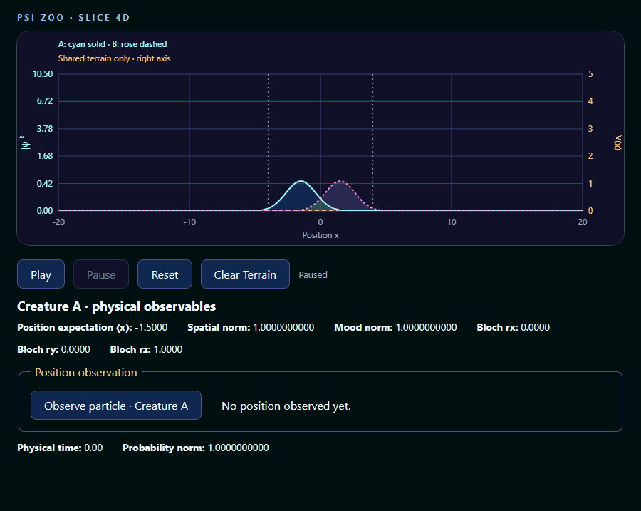
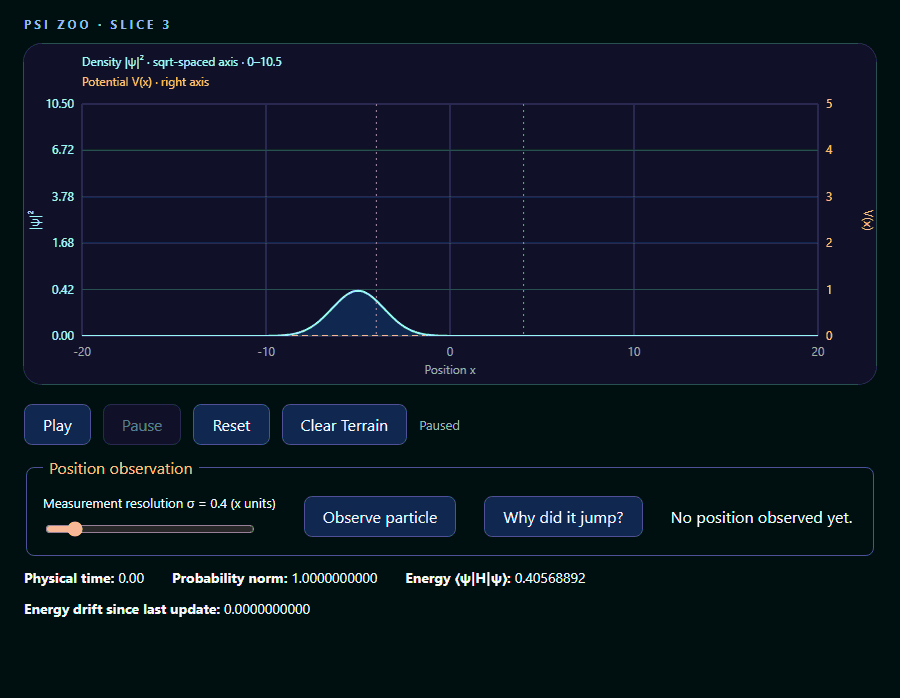
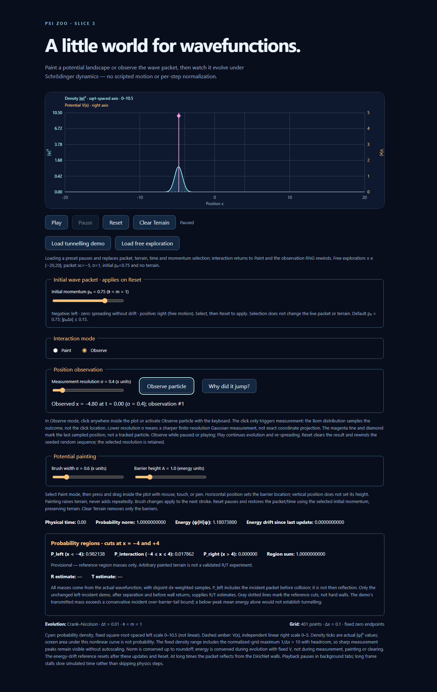
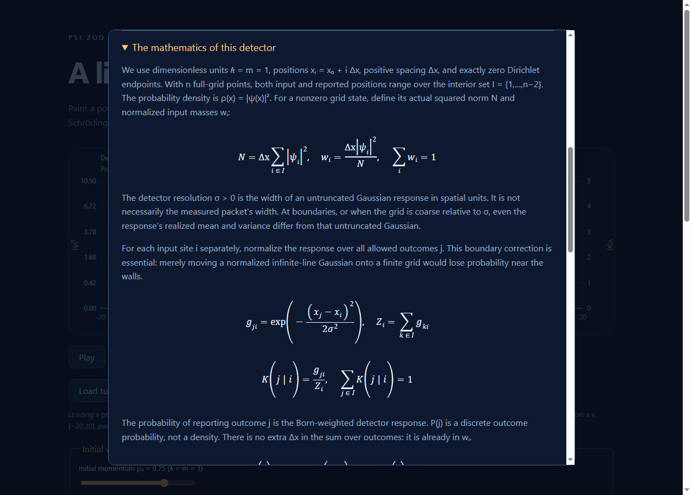

# Psi Zoo

A quantum-creature terrarium for learning, playing, and formally exploring
Schrödinger dynamics.

**Now starts with two interacting creatures.** Play the numerical mean-field
simulation, select A or B to inspect its qubit mood, paint shared terrain, and
observe only the selected creature. Compare attraction, independence, and
repulsion from identical initial conditions using **Apply coupling & Reset**.
[Slice 4D controls, validation, and limitations](docs/TWO_CREATURE_BROWSER_VALIDATION.md).



**Slice 4 — The Creature:** genuine browser capture of the default g=1.5 scene.
Both densities evolve; observing A at t=3.46 localizes only A, which then
re-spreads through t=7.42. White marks the sampled x=−0.20, not a trajectory.
The 10.52-second recording includes paused holds, with no invented physics frames.
Opposite mood forces are real but modest and mirror-symmetric; a controlled
[counterfactual comparison](docs/TWO_CREATURE_BROWSER_VALIDATION.md#mood-dependent-behaviour-acceptance)
is the evidence for their causal effect, not the GIF alone.
[Capture provenance](docs/TWO_CREATURE_BROWSER_VALIDATION.md#authentic-slice-4-gif).

The recordings below document the retained single-packet presets.



**Slice 3 — The Observer:** authentic browser recording of initial free evolution,
a position measurement at t=1.96, and subsequent re-spreading through t=5.94.
The magenta marker records the sampled x=−3.30, not a moving particle. The roughly
9-second GIF includes brief paused holds; evolution pacing is otherwise sampled
from the running app. [Capture provenance](docs/OBSERVER_VALIDATION.md#authentic-observer-gif).


Actual **Crank–Nicolson evolution**, not scripted motion: a Gaussian wave packet
scatters from a barrier, producing quantum reflection and transmission. The app
also supports **user-editable potential barriers**. This browser recording shows
physical time 0–44 at approximately **2.5× playback speed**, in dimensionless units
(ℏ = m = 1). The unchanged tunnelling demo gives **R ≈ 0.800, T ≈ 0.200 at t=44**;
the absolute numerical uncertainty budget is about 0.0015, not exact continuum
accuracy. [Capture provenance and numerical evidence](docs/SCATTERING_VALIDATION.md).

**Status:** Slice 4 final release-readiness checks pass, pending user review. **296 automated
tests**, TypeScript checks, production build, and strict DOM-free controller/world
compilation pass. Real Chrome checks passed for the two-creature scene (22 checks)
and retained Observer scene (14 checks), with no runtime/console errors. This is
not a claim of exhaustive manual device or accessibility acceptance. No automatic
commit or push. [Slice 4D validation](docs/TWO_CREATURE_BROWSER_VALIDATION.md).
[Historical Slice 3 validation and capture provenance](docs/OBSERVER_VALIDATION.md).
See [the roadmap](docs/ROADMAP.md), [scattering validation and capture sequence](docs/SCATTERING_VALIDATION.md),
[potential painting guide](docs/POTENTIAL_LANDSCAPES.md),
[directed packet validation](docs/DIRECTED_GAUSSIAN_VALIDATION.md), and
[Gaussian spreading validation](docs/FREE_GAUSSIAN_VALIDATION.md).

## Explore the project

- **Run the simulation:** [local development](#local-development) and [browser behavior](#browser-simulation).
- **Understand the physics:** [lab notebook](docs/notebook/README.md), starting with
  [The Observer — Why does the wavefunction collapse?](packages/web/src/content/notebook/observer.md)
  (also available in-app through **Why did it jump?**) and
  [why the wave packet keeps its probability](docs/notebook/crank-nicolson.md).
- **Inspect the evidence:** [scattering/tunnelling experiments](docs/SCATTERING_VALIDATION.md),
  [Gaussian spreading measurements](docs/FREE_GAUSSIAN_VALIDATION.md)
  and [conservation tests](packages/sim-core/tests/crankNicolson.test.ts).
- **Read the formal proofs:** [Lean companion repository](https://github.com/MaryShooshtari/psi-zoo-proofs)
  and [exact theorem-to-source map](docs/notebook/crank-nicolson.md#7-exact-statement-to-source-map).

The completed Lean proof chain establishes exact norm conservation, unique
solvability, explicit evolution, and matrix unitarity for the finite interior
Dirichlet model. **The TypeScript implementation is numerically tested, not
formally verified.** The notebook links the two kinds of evidence and states
what remains outside their scope. The Observer entry is bundled Markdown with
native MathML equations, rendered in a small browser notebook dialog without
new dependencies. The older CN entry remains documentation-only.

## Browser simulation

### Two-creature demonstration (default)

Starts paused with **Paint** selected, no terrain, and g=1.5. Two normalized
packets start at x=−1.5/+1.5 with density sigma=0.8 and momenta +0.5/−0.5 on
[-20,20], dx=0.1, dt=0.01. Opposite initial Bloch rz values and independent
qubit precession supply modest mood-dependent forces through the Hamiltonian.
No scripted positions or per-step normalization are used.

- **Play / Pause:** advance both creatures synchronously using fixed steps.
- **Creature A / B:** select the inspection and observation target. Inspect
  position expectation, spatial probability norm, mood norm and all three Bloch
  coordinates; the small diagram is an x–z projection, not a personality dial.
- **Social coupling:** choose g in [-3,3], then **Apply coupling & Reset**.
  Negative attracts, zero decouples, positive repels. The slider is pending until
  Reset; comparisons use identical initial packets and the same current terrain.
- **Reset:** pause, restore both initial states/time, apply pending coupling,
  clear both observation histories and rewind the seeded RNG; preserve terrain.
- **Load two-creature demo:** also clear terrain. **Clear Terrain** does not
  change either state, time, or play/pause status.
- **Paint / Observe:** paint barriers shared by both Hamiltonians, or use the
  existing Gaussian position observation on the selected creature only. The
  partner and both moods do not collapse. Per-creature result text and the white
  last-observation marker follow selection. The notebook is still available.

Cyan solid and rose short-dashed curves are **separate** probability densities on
the same fixed square-root-spaced scale. Faint fills identify the curves, not
complex phase or extra probability. Overlap is not coherent interference: no
cross-creature amplitudes are summed. The amber long-dashed curve shows shared
terrain only, not each creature's total mood/social potential.

Social potentials are g times the other density: a deterministic mean-field
model, **not entanglement or an exact two-particle wavefunction**. Frozen-density
feedback is first-order in time. Individual energies need not be conserved;
combined nonlinear energy is not exactly conserved by the numerical scheme.
Accordingly, the old static-energy drift and R/T readouts are not shown in this
mode. Finite grids, walls, strong coupling, sharp measurements, solver phase
error and safe-copying overhead remain limitations.
See [browser validation](docs/TWO_CREATURE_BROWSER_VALIDATION.md) and
[mathematical interaction validation](docs/SOCIAL_INTERACTION_VALIDATION.md).

### Retained single-packet presets

The following controls/readouts describe **Load free exploration** and **Load
tunnelling demo**, which remain available alongside the new default scene.

Free exploration starts paused with no terrain and **Paint** selected. Use **Play** and **Pause**
to evolve the packet. Paint and Observe are mutually exclusive. In **Paint**, press/drag inside the plot
with mouse, touch, or pen. Horizontal position sets the location; brush controls
set width sigma (0.3–2 spatial units) and height A (0.1–5 energy units). Defaults
are sigma=0.6 and A=1. Brush settings are held fixed until the stroke ends.
Sparse pointer events produce continuous strokes; repeated painting raises
terrain using max, not accumulation. Painting works paused or running and never
changes the wavefunction directly. Captured dragging outside clamps to the domain
edges; cancellation, focus loss, or disabling painting ends the stroke. Touch
scrolling is disabled over the canvas (scroll elsewhere on the page).

The **Initial momentum p₀** slider selects a value from −1.5 to +1.5; the default
remains +0.75. Negative launches left, zero spreads without drift, and positive
launches right in free space. **Selection only applies on Reset**: changing it
while playing does not kick or replace the live packet.

**Reset** pauses and regenerates the initial packet with the selected momentum at
t=0, **preserving terrain**. **Clear Terrain** removes barriers without changing
the packet, time, playback, or selected momentum. Reset uses the current mode's
initial center/width; it does not reload an edited or cleared barrier.

**Load tunnelling demo** pauses and replaces packet, terrain, time and momentum
selection with the validated large-domain setup: x in [-120,120], 2401 points,
dx=0.1, dt=0.02, center=-24, density sigma=3, p₀=1.5, Gaussian barrier centered at 0
with height 1.8 and width 0.6. Interaction returns to Paint. **Load
free exploration** explicitly returns to the original small free scene and
p₀=0.75. Mode loads replace terrain (and its array when changing grids); ordinary
painting, Reset and Clear Terrain preserve array identity.

Regional masses always come from actual ψ: left x<-4, interaction [-4,4], right
x>4. **Left mass includes the incoming packet and is not then reflection.** R/T
estimates appear only for the unchanged demo at t=40–44 after separation, with
negligible interaction/boundary mass. Expect R≈0.8002, T≈0.1998, with about
0.0015 absolute numerical uncertainty, not precision at all displayed digits.
Painting/clearing or resetting with another momentum invalidates quantitative
interpretation until a demo reload. Observation also immediately withholds R/T;
Reset clears the observation invalidation but does not repair edited terrain. Merely changing the pending selection does
not alter the current run. Outside the validated window, R/T is withheld.

The default incident mean kinetic energy (~1.137) is below the 1.8 peak, but that
alone would not establish tunnelling: its Gaussian high-energy tail is nonzero.
An incident over-barrier-tail bound <0.009755, convergence tests, and an independent
packet-weighted stationary benchmark support substantial sub-barrier transmission.
See [parameters, measured results, limitations and GIF capture steps](docs/SCATTERING_VALIDATION.md).

The plot displays cyan probability density on a **fixed square-root-spaced left
axis**, 0–10.5 at dx=0.1, and dashed amber V(x) on an independent **linear** right
axis, 0–5. Density tick labels are actual |ψ|² values, not square roots. A
normalized grid state has density at most 1/dx=10, so 5% headroom keeps even a
single-site peak visible. There is **no autoscaling** as the packet evolves.
The nonlinear display keeps broad packets legible, but geometric screen area is
not probability; compare the labeled densities and use the norm diagnostic.
Time, norm and energy come from the current state/terrain. Norm is conserved up
to roundoff. Energy is conserved during fixed-H evolution, **not across observation,
painting or clearing**; the displayed energy-drift reference resets at those
updates and Reset. The canvas updates immediately even while paused.

Free exploration defaults: x in [-20,20], 401 points, dx=0.1, dt=0.01, hbar=m=1,
V=0, center=-5, density standard deviation=1, momentum k0=0.75.
Dirichlet endpoints are zeroed before the single initial normalization. There is
no normalization during evolution. The momentum control keeps |p₀*dx| ≤ 0.15.
Continuum carrier velocity p₀ differs from finite-difference group velocity
sin(p₀*dx)/dx; finite packet width and CN temporal dispersion further affect its
centroid. See [velocity references and tolerances](docs/DIRECTED_GAUSSIAN_VALIDATION.md).
At long times the packet reflects from the Dirichlet walls; negative-momentum
packets start closer to their destination wall.

Playback uses elapsed wall time and fixed numerical steps, normally at one physical
time unit per wall second. Work is capped at eight steps per frame; excess wall
time after a stall is discarded rather than changing dt. Background tabs pause.
React diagnostics refresh at most ten times per second during playback/painting,
with a trailing update for the final paused edit; explicit buttons refresh
immediately. Canvas draws each frame and on terrain edits. Unmount cancels
playback, releases pointer capture, removes listeners, and clears pending UI timers.
Stale playback callbacks cannot restart a loop.

Vite, TypeScript, and Vitest resolve `@psi-zoo/sim-core` directly to its workspace
public source entry, avoiding stale installed workspace copies.

The Node-based Vitest setup tests playback with a fake frame scheduler, including
actual numerical acceptance results, diagnostics, refresh-rate independence,
terrain identity/solver propagation, reset versus clear, and disposal. Pointer
listeners are tested with an EventTarget/capture test double: CSS coordinate
mapping, plot edges, mouse/touch/pen strokes, cancellation, and cleanup, including
integration with the actual playback controller. It does not mount React, test
Canvas pixels, or emulate a real browser's capture implementation. See the
[manual browser checklist](docs/POTENTIAL_LANDSCAPES.md#manual-browser-checklist)
for device input, HiDPI, evolving density, and lifecycle regression checks. The
momentum-control review was accepted by the user with Phase 3A. The user reports
8/8 Phase 3B browser acceptance checks passed. The
[retained browser regression checklist and capture provenance](docs/SCATTERING_VALIDATION.md#browser-behavior-and-remaining-manual-checks)
distinguish that acceptance from the coding agent's actual Chrome demo capture;
the capture does not itself repeat all device/input acceptance checks.

## Observe and learn — Slice 3



In two-creature mode first select A or B; the same detector acts only on that
creature, with no partner measurement. The white marker follows its selected
history. The historical screenshots and magenta marker description below refer
to the retained single-packet mode.

Select **Observe** and click anywhere inside the plot, or focus **Observe particle**
and press Space/Enter. One action samples one outcome using the existing
finite-resolution Gaussian POVM. **The click triggers measurement; it does not
choose the position.** The magenta line/diamond and result text record the actual
sampled position and time, not a tracked particle. Observation works paused or
playing, preserves time and terrain, and replaces the wavefunction with the
normalized conditional state. Play then continues the same CN evolution.
Free packets re-spread; arbitrary painted potentials need not broaden monotonically.

**Measurement resolution σ** is the detector response width in spatial units,
not necessarily the resulting packet width. Smaller σ means sharper measurement.
The slider runs from 0.2 to 2.0 (default 0.4; dx=0.1, initial free density width=1).
The response is normalized separately for each input site over interior outcomes,
including near boundaries. This is not exact coordinate projection or a detailed
apparatus model, and arbitrary post-measurement states need not be Gaussian.

**Why did it jump?** opens the notebook next to the observation controls and
pauses playback for reading. Start with the intuitive explanation; expand the
detector mathematics, evolution/energy explanation and Lean evidence when ready.
The last observation supplies a clearly labeled numerical example, including its
discrete P(j), not a probability density. Close or Escape returns focus to the
trigger; use Play to resume. Equations use native MathML in modern browsers.



The controller owns a seeded 32-bit LCG (default seed **831**, configurable through
its constructor). Only observation actions consume randomness; rendering, reading
diagnostics and changing sliders do not. Identical initial conditions, seed and
actions at the same numerical steps reproduce the results. Wall-clock clicking
on different frames is not a reproducible action schedule. **Reset and preset
loads rewind the RNG and clear the marker/count/result**; resolution is retained.
Reset pauses, restores initial time/packet with the selected momentum, and
preserves terrain, as before.

Measurement remains synchronous O(N²) and can underflow extremely small tails.
Repeated sharp observations can produce near-grid-scale states: normalization
and CN stability do not establish continuum accuracy there. Neither the POVM nor
TypeScript sampling is formally verified. The companion's checked exact
coordinate-projection theorem is a different operator; see the
[notebook](packages/web/src/content/notebook/observer.md) and
[release validation](docs/OBSERVER_VALIDATION.md) for precise scope.

## Local development

Requires Node >=22.19 and npm.

```bash
npm install
npm run dev
```

Open the URL printed by Vite (usually http://localhost:5173).

## Validate changes

```bash
npm run test
npm run typecheck
npm run build
```

Reproduce the deterministic headless scattering report (existing dev dependencies):

```bash
node scripts/scattering-report.mjs
```

Run the real Chrome integration checks (uses an installed Chrome, no added packages):

```bash
node scripts/creature-browser-check.mjs
node scripts/observer-browser-check.mjs --no-screenshots
```

Set `CHROME_PATH` if Chrome is not installed at the script's Windows default.
The new checker can save a temporary genuine screenshot with `--screenshot`;
legacy `--no-screenshots` preserves existing historical media. Capture the new
Slice 4 GIF without overwriting historical recordings:

```bash
node scripts/capture-observer-gif.mjs --creatures
```

## Directory structure

- `packages/web/src/world/`: browser-independent Creature and two-creature coordinator
- `docs/TWO_CREATURE_BROWSER_VALIDATION.md`: controls, browser checks and limitations
- `scripts/creature-browser-check.mjs`: real Chrome two-creature integration checks
- `packages/sim-core`: dependency-free numerical state, observables, and tested Crank–Nicolson solver
- `packages/web`: React + Vite + Canvas renderer and a small Markdown/MathML notebook
- `packages/web/src/content/notebook/`: browser notebook entries with frontmatter
- `docs/OBSERVER_VALIDATION.md`: Slice 3 checks, limitations and authentic screenshot provenance
- `scripts/observer-browser-check.mjs`: dependency-free Chrome acceptance checks and screenshots
- `scripts/capture-observer-gif.mjs`: authentic browser GIF capture and native-decoder verification
- `docs/PROJECT_SPEC.md`: initial project handover
- `docs/ROADMAP.md`: vertical slices
- `docs/notebook/`: Markdown explanations, derivations, and links to checked Lean statements
- `docs/FREE_GAUSSIAN_VALIDATION.md`: measured numerical results and tolerance rationale
- `docs/SCATTERING_VALIDATION.md`: scattering/tunnelling results, convergence, tail bound, browser review and GIF capture
- `scripts/scattering-report.mjs`: reproducible development-only numerical report
- `AGENTS.md` and `.pi/prompts/`: coding agent guardrails and shortcuts

The separate [companion repository `psi-zoo-proofs`](https://github.com/MaryShooshtari/psi-zoo-proofs)
contains the completed Crank–Nicolson matrix proof chain in Lean 4 + Mathlib.
See its [proof index and build instructions](https://github.com/MaryShooshtari/psi-zoo-proofs#completed-cranknicolson-proof-chain)
and the [lab-notebook explanation](docs/notebook/crank-nicolson.md).
