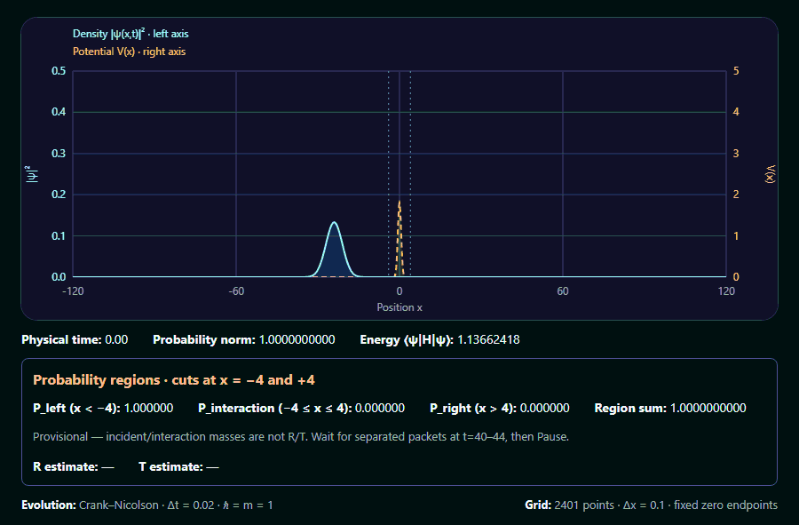

# Psi Zoo

A quantum-creature terrarium for learning, playing, and formally exploring
Schrödinger dynamics.



Actual **Crank–Nicolson evolution**, not scripted motion: a Gaussian wave packet
scatters from a barrier, producing quantum reflection and transmission. The app
also supports **user-editable potential barriers**. This browser recording shows
physical time 0–44 at approximately **2.5× playback speed**, in dimensionless units
(ℏ = m = 1). The unchanged tunnelling demo gives **R ≈ 0.800, T ≈ 0.200 at t=44**;
the absolute numerical uncertainty budget is about 0.0015, not exact continuum
accuracy. [Capture provenance and numerical evidence](docs/SCATTERING_VALIDATION.md).

**Status:** Slice 2 release candidate validated: 193 automated tests, TypeScript
checks, production build, numerical scattering/tunnelling validation, and
user-reported **8/8 Phase 3B browser acceptance checks**. Authentic demo GIF
captured; final release review pending. Slice 3 has not started.
See [the roadmap](docs/ROADMAP.md), [scattering validation and capture sequence](docs/SCATTERING_VALIDATION.md),
[potential painting guide](docs/POTENTIAL_LANDSCAPES.md),
[directed packet validation](docs/DIRECTED_GAUSSIAN_VALIDATION.md), and
[Gaussian spreading validation](docs/FREE_GAUSSIAN_VALIDATION.md).

## Explore the project

- **Run the simulation:** [local development](#local-development) and [browser behavior](#browser-simulation).
- **Understand the physics:** [lab notebook](docs/notebook/README.md), starting with
  [why the wave packet keeps its probability](docs/notebook/crank-nicolson.md).
- **Inspect the evidence:** [scattering/tunnelling experiments](docs/SCATTERING_VALIDATION.md),
  [Gaussian spreading measurements](docs/FREE_GAUSSIAN_VALIDATION.md)
  and [conservation tests](packages/sim-core/tests/crankNicolson.test.ts).
- **Read the formal proofs:** [Lean companion repository](https://github.com/MaryShooshtari/psi-zoo-proofs)
  and [exact theorem-to-source map](docs/notebook/crank-nicolson.md#7-exact-statement-to-source-map).

The completed Lean proof chain establishes exact norm conservation, unique
solvability, explicit evolution, and matrix unitarity for the finite interior
Dirichlet model. **The TypeScript implementation is numerically tested, not
formally verified.** The notebook links the two kinds of evidence and states
what remains outside their scope. Its content is Markdown only; it is not yet
rendered inside the browser app.

## Browser simulation

Starts paused with no terrain and Painting mode off. Use **Play** and **Pause**
to evolve the packet. Enable **Painting mode**, then press/drag inside the plot
with mouse, touch, or pen. Horizontal position sets the location; brush controls
set width sigma (0.3–2 spatial units) and height A (0.1–5 energy units). Defaults
are sigma=0.6 and A=1. Brush settings are held fixed until the stroke ends.
Sparse pointer events produce continuous strokes; repeated painting raises
terrain using max, not accumulation. Painting works paused or running and never
changes the wavefunction directly. Captured dragging outside clamps to the domain
edges; cancellation, focus loss, or disabling painting ends the stroke. Touch
scrolling is disabled over the canvas (scroll elsewhere on the page).

The **Initial momentum p₀** slider selects a value from −1.5 to +1.5; the default
remains +0.75. Negative launches left, zero spreads without drift, and positive
launches right in free space. **Selection only applies on Reset**: changing it
while playing does not kick or replace the live packet.

**Reset** pauses and regenerates the initial packet with the selected momentum at
t=0, **preserving terrain**. **Clear Terrain** removes barriers without changing
the packet, time, playback, or selected momentum. Reset uses the current mode's
initial center/width; it does not reload an edited or cleared barrier.

**Load tunnelling demo** pauses and replaces packet, terrain, time and momentum
selection with the validated large-domain setup: x in [-120,120], 2401 points,
dx=0.1, dt=0.02, center=-24, density sigma=3, p₀=1.5, Gaussian barrier centered at 0
with height 1.8 and width 0.6. Painting turns off but remains available. **Load
free exploration** explicitly returns to the original small free scene and
p₀=0.75. Mode loads replace terrain (and its array when changing grids); ordinary
painting, Reset and Clear Terrain preserve array identity.

Regional masses always come from actual ψ: left x<-4, interaction [-4,4], right
x>4. **Left mass includes the incoming packet and is not then reflection.** R/T
estimates appear only for the unchanged demo at t=40–44 after separation, with
negligible interaction/boundary mass. Expect R≈0.8002, T≈0.1998, with about
0.0015 absolute numerical uncertainty, not precision at all displayed digits.
Painting/clearing or resetting with another momentum invalidates quantitative
interpretation until a demo reload. Merely changing the pending selection does
not alter the current run. Outside the validated window, R/T is withheld.

The default incident mean kinetic energy (~1.137) is below the 1.8 peak, but that
alone would not establish tunnelling: its Gaussian high-energy tail is nonzero.
An incident over-barrier-tail bound <0.009755, convergence tests, and an independent
packet-weighted stationary benchmark support substantial sub-barrier transmission.
See [parameters, measured results, limitations and GIF capture steps](docs/SCATTERING_VALIDATION.md).

The plot displays cyan probability density on the left scale (0–0.5), and dashed
amber potential V(x) on the independent right scale (0–5). Both scales are fixed;
density peaks above 0.5 are clipped, not rescaled. Time, probability norm, and
energy are calculated from the current state and terrain. Norm is conserved up
to roundoff; energy is conserved only while V is unchanged, **not while painting
or clearing terrain**. The overlay updates immediately, even while paused.

Free exploration defaults: x in [-20,20], 401 points, dx=0.1, dt=0.01, hbar=m=1,
V=0, center=-5, density standard deviation=1, momentum k0=0.75.
Dirichlet endpoints are zeroed before the single initial normalization. There is
no normalization during evolution. The momentum control keeps |p₀*dx| ≤ 0.15.
Continuum carrier velocity p₀ differs from finite-difference group velocity
sin(p₀*dx)/dx; finite packet width and CN temporal dispersion further affect its
centroid. See [velocity references and tolerances](docs/DIRECTED_GAUSSIAN_VALIDATION.md).
At long times the packet reflects from the Dirichlet walls; negative-momentum
packets start closer to their destination wall.

Playback uses elapsed wall time and fixed numerical steps, normally at one physical
time unit per wall second. Work is capped at eight steps per frame; excess wall
time after a stall is discarded rather than changing dt. Background tabs pause.
React diagnostics refresh at most ten times per second during playback/painting,
with a trailing update for the final paused edit; explicit buttons refresh
immediately. Canvas draws each frame and on terrain edits. Unmount cancels
playback, releases pointer capture, removes listeners, and clears pending UI timers.
Stale playback callbacks cannot restart a loop.

Vite, TypeScript, and Vitest resolve `@psi-zoo/sim-core` directly to its workspace
public source entry, avoiding stale installed workspace copies.

The Node-based Vitest setup tests playback with a fake frame scheduler, including
actual numerical acceptance results, diagnostics, refresh-rate independence,
terrain identity/solver propagation, reset versus clear, and disposal. Pointer
listeners are tested with an EventTarget/capture test double: CSS coordinate
mapping, plot edges, mouse/touch/pen strokes, cancellation, and cleanup, including
integration with the actual playback controller. It does not mount React, test
Canvas pixels, or emulate a real browser's capture implementation. See the
[manual browser checklist](docs/POTENTIAL_LANDSCAPES.md#manual-browser-checklist)
for device input, HiDPI, evolving density, and lifecycle regression checks. The
momentum-control review was accepted by the user with Phase 3A. The user reports
8/8 Phase 3B browser acceptance checks passed. The
[retained browser regression checklist and capture provenance](docs/SCATTERING_VALIDATION.md#browser-behavior-and-remaining-manual-checks)
distinguish that acceptance from the coding agent's actual Chrome demo capture;
the capture does not itself repeat all device/input acceptance checks.

## Local development

Requires Node >=22.19 and npm.

```bash
npm install
npm run dev
```

Open the URL printed by Vite (usually http://localhost:5173).

## Validate changes

```bash
npm run test
npm run typecheck
npm run build
```

Reproduce the deterministic headless scattering report (existing dev dependencies):

```bash
node scripts/scattering-report.mjs
```

## Directory structure

- `packages/sim-core`: dependency-free numerical state, observables, and tested Crank–Nicolson solver
- `packages/web`: React + Vite + Canvas renderer
- `docs/PROJECT_SPEC.md`: initial project handover
- `docs/ROADMAP.md`: vertical slices
- `docs/notebook/`: Markdown explanations, derivations, and links to checked Lean statements
- `docs/FREE_GAUSSIAN_VALIDATION.md`: measured numerical results and tolerance rationale
- `docs/SCATTERING_VALIDATION.md`: scattering/tunnelling results, convergence, tail bound, browser review and GIF capture
- `scripts/scattering-report.mjs`: reproducible development-only numerical report
- `AGENTS.md` and `.pi/prompts/`: coding agent guardrails and shortcuts

The separate [companion repository `psi-zoo-proofs`](https://github.com/MaryShooshtari/psi-zoo-proofs)
contains the completed Crank–Nicolson matrix proof chain in Lean 4 + Mathlib.
See its [proof index and build instructions](https://github.com/MaryShooshtari/psi-zoo-proofs#completed-cranknicolson-proof-chain)
and the [lab-notebook explanation](docs/notebook/crank-nicolson.md).
