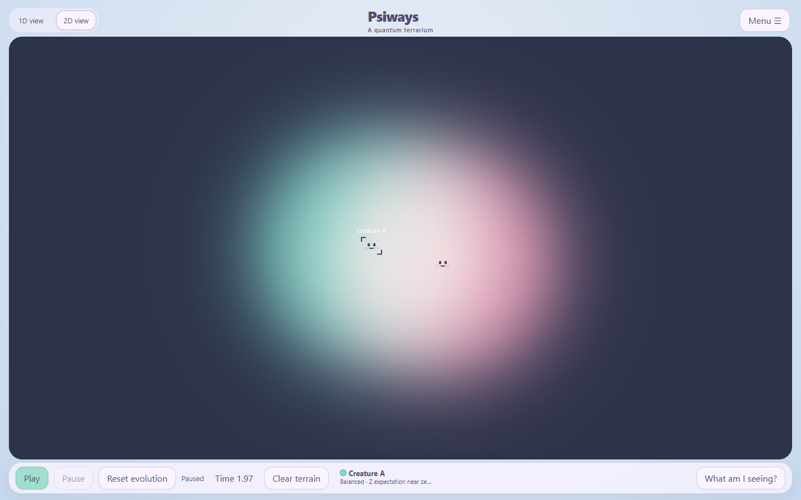
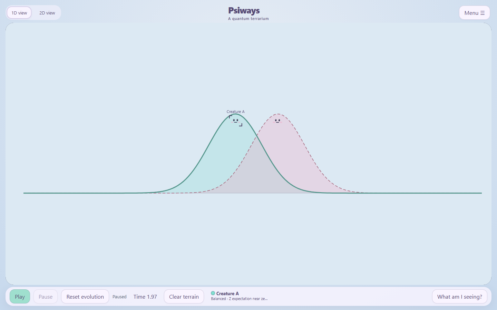
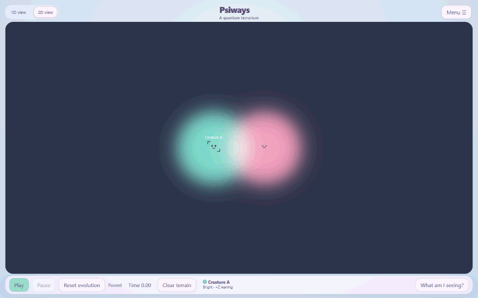
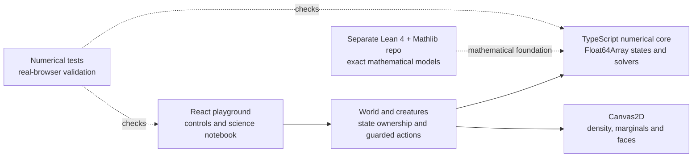

# Psiways

### A small playground for big quantum ideas.

Real wavefunctions. Playful creatures. Physics you can reach out and change.

[](packages/sim-core/src/index.ts) [](packages/web/src) [](https://github.com/MaryShooshtari/psi-zoo-proofs)



**Psiways is an interactive quantum playground.** Each creature has a numerically simulated complex wavefunction. Its cloud spreads and responds to potential energy through Schrödinger evolution—not a scripted path or a decorative particle animation. Tiny faces make the mathematics approachable without moving the probability underneath.

**[Run it locally ↓](#run-it-locally)** · **[Explore the physics](#the-physics-is-real)** · **[Read the notebook](docs/notebook/README.md)** · **[Inspect the evidence](#validation-and-current-status)**

## What can you explore?

- **One world, two ways to look.** See probability density as a 2D cloud, then reveal its 1D distribution along x. Switching views keeps the same state, terrain and physical time.
- **Spreading, not wandering.** Press Play and watch a localized packet evolve. A free packet can broaden even when its mean momentum is zero; fading brightness is not lost probability.
- **Ask where it is.** Measure a creature’s position to sample a result and relocalize its state with a finite-resolution detector. Resume evolution and watch what happens next. Clicking chooses the creature, not the reported position.
- **Draw an energy landscape.** Paint barriers and wells, or erase them while evolution continues. Explore reflection, scattering and transmission. Not every cloud beyond a barrier is tunnelling: energy spread and paths around a finite obstacle matter. Separate calibrated 1D demonstrations provide a more controlled comparison.
- **Meet other creatures.** Add up to four independent spatial states and explore optional approximate interaction potentials. Overlapping colors do not create interference between independent creatures.
- **Try a quantum mood.** Each mood is a two-level quantum system—a qubit, not a literal emotion. Different measurement bases ask different quantum questions.
- **Prepare a shared state.** Give two creatures a Bell-state mood and compare measurement records across fresh preparations. Their moods can be entangled; their spatial clouds remain independent. Correlation is not faster-than-light communication.
- **Follow your curiosity.** Open **What am I seeing?** for contextual explanations, a seven-step learning path in your existing scene, or ten notebook chapters that lead from observation to mathematics. The learning path never resets your scene on entry; experiment-changing actions remain explicit.



*The 1D hills are a quantum shadow of the same 2D world—not a second simulation or a measurement.*

<details>
<summary><strong>Watch the wavefunctions evolve</strong></summary>



Real browser frames, not invented intermediate states. Only the presentation is reduced in size; the simulation grid and timestep are unchanged. [Capture method and provenance](docs/assets/README.md).

</details>

## The physics is real

The starting point is the time-dependent Schrödinger equation:

$$
i\hbar\frac{\partial\psi}{\partial t}=\left(-\frac{\hbar^2}{2m}\nabla^2+V\right)\psi
$$

Here the wavefunction carries both amplitude and phase; the cloud displays probability density, not the full quantum state. The 1D view sums over the coordinate you are no longer looking at:

$$
\rho(x,y,t)=|\psi(x,y,t)|^2,
\qquad
\rho_x(x,t)=\int\rho(x,y,t)\mathrm{d}y
$$

On the finite grid, that integral becomes a spacing-weighted sum. Each creature’s total spatial probability is one, up to floating-point error. Cloud brightness uses a fixed nonlinear display mapping, so brightness and geometric screen area are not linear probability scales.

**What is actually simulated:**

- **Dimensionless units:** $\hbar=m=1$. The rectangular domain is chosen at initial mount with approximately 128² interior samples, fixed spacing `20/129` and timestep `1/120`. Resizing redraws the existing world; it does not resample its wavefunctions.
- **Numerical evolution:** centered finite differences, symmetric directional **Cayley kinetic splitting** and real-potential phase evolution. The 2D step is `P(dt/2) Cx(dt/2) Cy(dt) Cx(dt/2) P(dt/2)`, not an unsplit 2D Crank–Nicolson solve. It preserves the discrete norm to roundoff; full-H energy is not exactly conserved by this split method. The separate 1D solver uses Crank–Nicolson.
- **Finite boundaries:** zero-Dirichlet values on all four spatial edges. Waves eventually reflect; free-space interpretations are limited to times before boundary returns.
- **Position observation:** a boundary-normalized, finite-resolution **Gaussian generalized measurement** followed by a conditional state update—not an ideal position eigenstate projection. In 1D view it measures x on the full 2D state, not y.
- **Multiple creatures:** separate spatial wavefunctions with optional deterministic **mean-field** feedback. This is an approximate model, generally first-order in time when feedback is enabled—not exact many-body dynamics or spatial entanglement.
- **Mood qubits:** independent two-amplitude states or a genuine four-amplitude joint two-qubit state. Bell preparation can create mood entanglement. Registered pair members have mood-dependent spatial feedback suspended, avoiding a spurious signalling channel through the approximate force model.

One reference preparation is the Bell state:

$$
|\Phi^+\rangle=\frac{|00\rangle+|11\rangle}{\sqrt{2}}
$$

Its local outcomes can be random even when same-basis joint outcomes are correlated. Comparing those records requires ordinary information exchange. A single matching pair of outcomes does not establish entanglement experimentally.

For assumptions, tolerances and independent comparisons, see the [domain and numerical validation](docs/PLAYGROUND_DOMAIN_VALIDATION.md), [scattering study](docs/SCATTERING_VALIDATION.md) and [entangled-mood model](docs/ENTANGLEMENT_2D_VALIDATION.md).

## How it works



| Layer | Responsibility |
| --- | --- |
| [`packages/sim-core`](packages/sim-core) | DOM-free TypeScript: complex grids, observables, evolution, Gaussian measurements and qubit mathematics. Numerical buffers use `Float64Array`. |
| [`world`](packages/web/src/world) | Browser-independent creature ownership, mood pairs, presets and approximate interactions. |
| [`packages/web`](packages/web) | React/Vite interface, Canvas2D rendering, explicit target/arming workflows, contextual science and locally bundled Markdown/MathML notebooks. |
| [`scripts`](scripts) | Numerical reports and real Chrome checks for state continuity, interactions, rendering, failure recovery and bounded performance. |
| [Lean companion](https://github.com/MaryShooshtari/psi-zoo-proofs) | Separate formal mathematics for specific finite-dimensional evolution, qubit and measurement models. **Not formal verification of the TypeScript implementation or the whole game.** |

The solver advances in fixed physical steps, independently of display refresh. Rendering and face animation do not sample quantum outcomes. One guarded action executor owns creature mutations; display-recovery retries redraw committed results rather than repeating a measurement.

## Run it locally

Use **Node.js 24 LTS** and npm (the CI workflow uses Node 24).

```bash
git clone https://github.com/MaryShooshtari/psi-zoo.git
cd psi-zoo
npm ci
npm run dev
```

Open the URL printed by Vite, normally **http://localhost:5173**. No account or backend is required. The repository and workspace identifiers intentionally retain their original `psi-zoo` names for compatibility; the application is **Psiways**.

```bash
npm run test       # Vitest numerical, controller and UI-support tests
npm run typecheck  # Both TypeScript workspaces
npm run build      # Typecheck, then the Vite production build
```

The production files are written to `packages/web/dist`. No public deployment URL is currently documented or verified; local development is the supported entry point here.

<details>
<summary>Reproduce focused browser validation</summary>

These scripts use an installed Chrome and the repository’s existing tooling. On non-default installations, set `CHROME_PATH` to the Chrome executable. Run them serially; they share fixed local ports.

```bash
node scripts/projection-browser-check.mjs --learning
node scripts/projection-browser-check.mjs --playground
node scripts/spatial-actions-browser-check.mjs
node scripts/projection-browser-check.mjs --redesign
```

Screenshots and audit output are written to temporary directories, not shipped in the application. These checks are not a substitute for real-device or assistive-technology testing.

</details>

## Validation and current status

**Implemented and usable:** the rectangular 2D terrarium, state-preserving 1D marginal view, editable potentials, position measurements, up to four creatures, optional approximate interactions, shared mood qubits, contextual help, the learning path and the physics notebook.

The numerical work includes norm checks, independent free-Gaussian width conventions, static-H energy tests where applicable, full-state convergence comparisons, measurement probabilities, joint-state invariants and no-signalling algebraic checks. Browser checks exercise the actual mounted controls, including stale requests and redraw-only recovery—not just screenshots.

**Still under review:** sustained and four-creature smoothness, real touch/pen devices, actual screen readers, hardware zoom/high-DPI behavior and human visual acceptance. Short successful playback probes do not close the sustained-performance gate. Arbitrary painted scenes are not calibrated tunnelling experiments, and fine measurement widths are not a blanket continuum-accuracy guarantee.

- [Latest branding, README, math and media verification](docs/PSIWAYS_BRANDING_VALIDATION.md)
- [Rectangular-domain validation and performance limitations](docs/PLAYGROUND_DOMAIN_VALIDATION.md)
- [Current roadmap](docs/ROADMAP.md) and [session handoff](docs/SESSION_HANDOFF.md)
- [Mathematical notebook and theorem/source map](docs/notebook/README.md)

Historical validation reports retain the project’s former name and the counts measured at their own checkpoints. They are evidence records, not current branding or a claim that every acceptance gate is complete.

## Why Psiways?

Quantum mechanics becomes easier to explore when you can interact with its mathematical consequences before studying the equations.

**The creatures are playful. Their wavefunctions follow simulated physics.**
