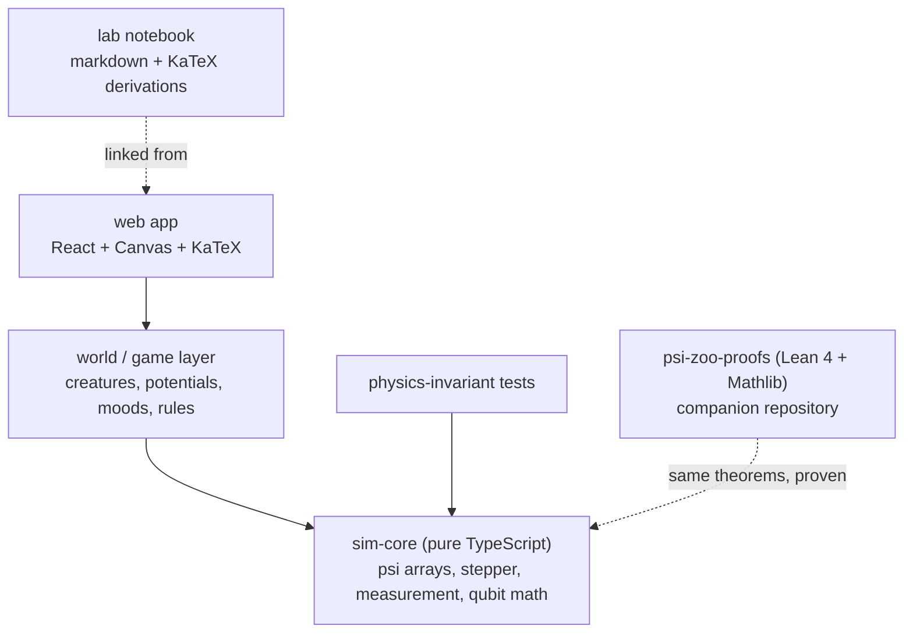
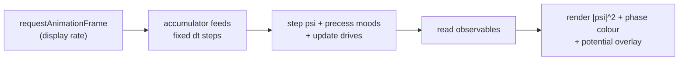

# Psi Zoo — Project Handover

*An interactive terrarium of quantum creatures: a browser game, a pedagogical physics explorable, and a formally verified simulation — one project, three audiences.*

---

## 1. What this project is

**Psi Zoo** is a browser-based interactive world in which the creatures are not *decorated* with physics — they *are* the physics. Each creature is a real wavefunction ψ(x, t), simulated honestly with the Schrödinger equation. It drifts, spreads, interferes, and tunnels through walls. Each creature also has a personality: its "mood" is a genuine two-level quantum system (a qubit on the Bloch sphere) that steers its behaviour. A companion Lean 4 repository proves the mathematical core of the simulation.

The project serves three audiences at once:

1. **The general public** — a Tamagotchi you can only understand by learning quantum mechanics. Glowing creatures, tunnelling, entangled friendships. Shareable GIFs market themselves.
2. **Students & educators** — every game mechanic is a lecture demo with the derivation attached (the "lab notebook" panel).
3. **The developer's portfolio** — a beautiful interactive repo plus a formalized-physics repo. It says: "I can build the thing *and* prove the thing."

## 2. Goals

### Product goals
- An interactive, fun, and *informative* web world where playing IS learning physics.
- Honest simulation: the visible behaviour must follow from the Schrödinger equation, not from scripted animation.
- A lab-notebook layer that scales with curiosity: casual players watch creatures; physics students open derivations.
- Polished, shareable output (GIFs, demo page) that gives the GitHub account visible life.

### Learning & craft goals (personal)
- Re-experience solving mathematical representations of physics: derivations, numerics, the beauty of a sim that matches the textbook answer.
- Learn Lean 4 and Mathlib by proving real statements about a real project.

### Non-goals (explicit)
- No attempt to verify the *whole game* in Lean — only the mathematical core.
- No multiplayer, no accounts, no backend, no database.
- No WebGL/WebGPU until a profiler proves Canvas2D is the bottleneck.
- No 3D. 1D first, then a 2D terrarium.

## 3. The world: mechanics and the physics they teach

| Game mechanic | Real physics the player just experienced |
| --- | --- |
| Creature is a soft glowing cloud | Superposition & the Born rule: \|ψ\|² as probability density |
| Click to observe → sharp dot → re-spread | Measurement collapse & wave-packet dispersion |
| Creature walks through a wall | Quantum tunnelling through a potential barrier |
| Two creatures pass through each other | Wavefunction interference; fringes visible in probability |
| Creature's mood dial / inspector | Bloch sphere, unitary precession, two-level systems |
| Best friends act in sync | Entanglement & correlated measurement (EPR-style) |
| Feed it / edit terrain = change V(x) | Hamiltonians: the potential shapes everything |

**Core loop:** the terrarium is a potential landscape. Creatures are wave packets evolving under Schrödinger dynamics. Observation is the signature game mechanic: clicking a creature collapses its cloud to a sharp position, which then visibly re-spreads. Moods precess under a "mood Hamiltonian" and couple to the external potential — a curious mood flattens barriers (more tunnelling), an anxious mood deepens its own well (stays put). Social life emerges from pairwise interaction potentials (attraction wells, repulsive cores) tuned by mood. Two creatures can become entangled ("friendship"): measure one, and you instantly know something about the other.

## 4. Architecture: three rings, one direction

The governing principle: **the mathematics must not know the game exists, and the game must not know the browser exists.** Three layers, each depending only inward:



Why this buys seamless development:

- `sim-core` runs in Node for tests, headless for replays, and can move to a Web Worker or GPU later without touching any calling site.
- The world layer is small and testable without a browser.
- The UI layer stays dumb and replaceable.

## 5. Component breakdown

### 5.1 `sim-core` — a dependency-free TypeScript package

The heart of the project. Five modules:

1. **State & math.** ψ stored as an interleaved `Float64Array` (re, im pairs) on a power-of-2 grid; V stored as a `Float64Array`. Dimensionless units everywhere: **ħ = m = 1** — decided once, written at the top of the file, never revisited. A tiny complex-array helper (add, scale, norm, inner product) is all the linear algebra needed.
2. **The stepper.** One interface, swappable implementations:

```ts
export interface Stepper {
  /** Evolve psi by dt under potential V; exactly unitary if possible. */
  step(psi: PsiGrid, V: Float64Array, dt: number): void;
}
```

3. **Measurement operators.** Position collapse = multiply by a Gaussian mask at the click point, then renormalize; projection onto the ground state of a well. Pure functions: `(PsiGrid) → PsiGrid`.
4. **Observables.** ⟨x⟩, ⟨p⟩, ⟨H⟩, norm. These are both UI candy and the physics instrumentation used by the test suite.
5. **The qubit / mood engine.** Separate and tiny: a 2-component complex state, evolution under H = **a**·**σ** via the closed-form 2×2 matrix exponential, plus a Bloch-vector extractor for rendering.

### 5.2 World / game layer

- A **`Creature`** = { ψ-grid, mood qubit, drive parameters }.
- The terrain is a **composed potential**: base landscape + walls + food wells + pairwise social terms — all just summed `Float64Array`s before each solve.
- The "brain" is small (~200 lines): mood state → drive weights → a shallow gradient bias added to V. This mapping (qubit → behaviour) is where the creature-personality magic lives.
- An event bus connects world events to UI panels and notebook entries.

### 5.3 UI layer

- **Canvas2D is enough for a long time.** Even a 256×256 terrarium is just building an `ImageData` per frame. React is only used for inspector panels; the Bloch sphere widget is a hand-rolled canvas (~150 lines).
- **Phase-aware rendering:** colour by hue = arg ψ, brightness = |ψ|². It looks gorgeous *and* it shows interference — two overlapping creatures produce visible hue ripples. Graphics and physics agree for free.
- **Lab notebook:** entries as plain markdown files with frontmatter (topic, equation, which mechanic links here), rendered with KaTeX. A folder of files is the whole content pipeline.

### 5.4 `psi-zoo-proofs` — the Lean 4 companion repository

Separate repository (Mathlib's build cache is enormous and must not pollute the app repo). The honest, achievable theorem sequence, ordered by difficulty:

1. **Cayley transform unitarity (flagship):** for Hermitian H, the Crank–Nicolson step (I − iHΔt/2)(I + iHΔt/2)⁻¹ is unitary. Finite-dimensional matrix analysis — squarely in Mathlib's strength.
2. **Collapse is a projection:** position measurement on a finite grid = orthogonal projection onto a coordinate basis vector; renormalization divides by the norm.
3. **Bloch precession is a rotation:** unitary qubit evolution preserves the Bloch sphere metric.

The link between repos is **editorial, not mechanical**: each Lean theorem's statement is copied into the corresponding lab-notebook entry in plain math, together with the Lean file name. The reader can go see the machine-checked version. That cross-referencing *is* the project's distinctive feature.

## 6. Key technical decisions & rationale

| Decision | Why |
| --- | --- |
| **Crank–Nicolson (CN), not split-step Fourier (SSFM)** | CN is *exactly unitary* for any dt — norm conserved to machine precision, and that is the property the Lean repo proves, so implementation and proof talk about the same object. In 1D CN reduces to a tridiagonal solve per step (Thomas algorithm, ~30 lines, O(N)). SSFM needs FFT and has a nasty trap: its boundary conditions are periodic, so creatures would wrap around the world's edge. CN with Dirichlet walls just contains them. |
| **1D first** | Vastly simpler numerics while still showing superposition, tunnelling, spreading, collapse. The `Stepper` interface makes the 2D upgrade (ADI Crank–Nicolson — two tridiagonal sweeps per step, feasible at 256×256 in plain JS) a local change. |
| **Dimensionless units (ħ = m = 1)** | Removes a whole class of numerical and conceptual bugs. |
| **`Float64Array` everywhere in sim** | Machine-precision physics tests demand doubles. Convert to `Float32Array` only when handing buffers to the renderer. |
| **TypeScript strict mode, everywhere** | The type of `PsiGrid` and `Stepper` is documentation that cannot rot. |
| **Canvas2D, no WebGL yet** | Simplicity first; the profile decides when to upgrade. |
| **Lean in a separate repo** | Mathlib build weight; each repo keeps a clean CI. |
| **Monorepo for TS packages** | `sim-core` and `web` share types, versions, and CI without publishing ceremony. |

## 7. The frame loop

Physics runs on a fixed timestep, decoupled from display rate (classic accumulator pattern):



- Fixed physics dt (e.g. 1/120 s), seeded randomness, input events recorded as data.
- **Determinism & replay:** when (not if) a creature "explodes," replay the exact input script and debug headlessly. Non-negotiable for a physics sandbox.

## 8. Testing strategy: the physics is the test suite

Every stepper must pass machine-precision invariant checks:

- `norm(ψ) = 1` after 10,000 steps.
- ⟨H⟩ constant for static V (energy conservation).
- **Validation against the analytic free Gaussian:** the width of a free Gaussian wave packet has the closed form σ(t) = σ₀ √(1 + (t / 2σ₀²)²). When the simulation matches this curve, the core is right before the first pixel is drawn.

Working discipline: **every new physics claim gets a test before it gets a feature.**

## 9. Repository layout

```
psi-zoo/                      # TypeScript monorepo (app)
  packages/
    sim-core/                 # pure math: zero DOM deps, runs in Node
      src/
        grid.ts               # PsiGrid, complex array helpers
        stepper.ts            # Stepper interface
        crank-nicolson.ts     # CN + Thomas tridiagonal solver
        measurement.ts        # collapse, projections
        observables.ts        # norm, <x>, <p>, <H>
        qubit.ts              # 2-level system, Bloch vector
      tests/                  # physics-invariant tests
    web/                      # Vite + React + Canvas app
      src/
        render/               # |psi|^2 strip, phase hue, overlay
        world/                # Creature, potential composition, drives
        ui/                   # inspector panels, Bloch widget, notebook
        content/notebook/     # markdown + frontmatter + KaTeX
  README.md                   # with the latest demo GIF

psi-zoo-proofs/               # Lean 4 + Mathlib companion repo
  PsiZoo/Cayley.lean          # CN step is unitary
  PsiZoo/Collapse.lean        # measurement is a projection
  PsiZoo/Bloch.lean           # Bloch evolution is a rotation
  lakefile.toml
  README.md                   # cross-links to notebook entries
```

## 10. Roadmap: vertical slices (no dates, no weeks)

Each slice ends **shippable**: app builds, tests pass, README GIF updated. The GitHub streak takes care of itself.

| Slice | Content | Definition of done |
| --- | --- | --- |
| **0 — Scaffold** | Vite + TypeScript strict + vitest + empty canvas running the fixed-timestep loop | A rectangle animates smoothly at fixed dt |
| **1 — "A Gaussian that lives"** | Complex arrays, CN stepper with Thomas solve; same sitting: the analytic-width test | The cloud spreads on screen AND the σ(t) test is green — sim matches the exact solution |
| **2 — Touch the world** | Pointer-drag paints a potential bump; real-time scattering | First "wow" GIF for the README |
| **3 — The observer** | Click = collapse, then visible re-spreading; notebook entry on the Born rule | A player can collapse and re-spread a creature, and read why |
| **4 — The creature** | Wrap ψ + mood qubit into the `Creature` entity; mood biases the drive; add a second creature with a social potential | Two creatures interact and behave differently by mood |
| **5+ — The terrarium** | 2D via ADI Crank–Nicolson; entanglement mechanic; multiple creatures; terrain editing | A living, observable ecosystem |
| **Lean lane (parallel, slow burn)** | Natural Number Game first; then Collapse-is-a-projection; then the flagship Cayley unitarity theorem | Each finished proof cross-linked into the notebook |

The moment slice 1 is green — simulation matching the textbook solution — the project's foundation is laid. Everything after that is enrichment.

## 11. How the work starts (for whoever picks this up)

1. Read sections 3–5 of this document; do not skip the "why" column in section 6.
2. Create the monorepo skeleton (section 9) and get slice 0 building.
3. Implement slice 1 in one focused stretch: `grid.ts` → `crank-nicolson.ts` → the σ(t) test → only then the renderer.
4. Open the Lean repo on the side; start the Natural Number Game while the visual sim matures. Progress there is measured in weeks — accept it.
5. Keep two habits at all times: **every slice ends shippable**, and **every physics claim gets a test before it gets a feature**.

## 12. Resources

- Crank–Nicolson for the Schrödinger equation: any numerical PDE text; the tridiagonal (Thomas) algorithm is ~30 lines.
- The analytic free Gaussian: standard QM (e.g. Griffiths, *Introduction to Quantum Mechanics*), wave-packet spreading section.
- Lean 4 & Mathlib: the Natural Number Game (NNG4), *Mathematics in Lean*, and the Mathlib documentation.
- Explorable-explanation inspiration: Bartosz Ciechanowski's interactive articles; Bret Victor's "Explorable Explanations".
- Bloch sphere rendering: any 2D canvas orthographic projection suffices for the inspector.

---

*Psi Zoo is designed so that every working session ends with either a prettier creature or a deeper proof. Keep it that way.*